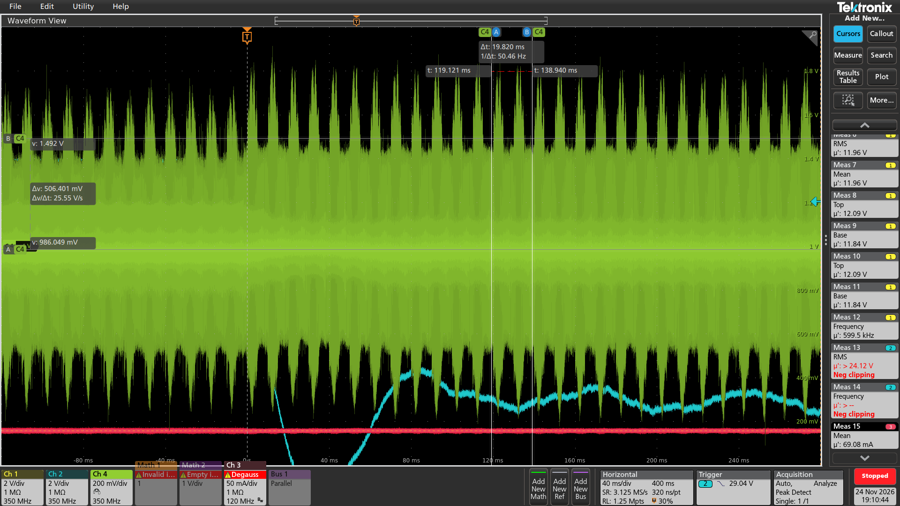

# Scope capture 2026-11-24T17:23:43 — dis01

- Instrument: TEKTRONIX,MSO54,C017217,CF:91.1CT FV:2.8.1.1496
- Acquisition: 0 / PEAKDETECT / stop after SEQUENCE, 1 acqs
- Timebase: 40 ms/div, record 1250000 pts, 3.125 MS/s
- Trigger: EDGE CH2 FALL @ 29.04 V, mode NORMAL

## Channels

| Ch | Label | Scale/div | Offset | Pos (div) | Coupling | BW | Term |
|---|---|---|---|---|---|---|---|
| CH1 |  | 2 V | 12 V | 0.0 | DC | 350 MHz | 1 MΩ |
| CH2 |  | 2 V | 27 V | 0.0 | DC | 350 MHz | 1 MΩ |
| CH3 |  | 50 mA | 280 mA | 0.0 | DC | 120 MHz | 1 MΩ |
| CH4 |  | 200 mV | 1 V | 0.0 | DC | 350 MHz | 250 kΩ |

## Measurements

| Meas | Type | Source | Current mean | All mean | All min | All max | All σ | N |
|---|---|---|---|---|---|---|---|---|
| MEAS1 | MEAN | CH2 | 22.03 V | 22.03 V | 22.03 V | 22.03 V | 0 V | 1 |
| MEAS2 | MEAN | CH4 | 977.5 mV | 977.5 mV | 977.5 mV | 977.5 mV | 0 V | 1 |
| MEAS3 | FREQUENCY | CH2 | — | — | — | — | — | 0 |
| MEAS4 | PWIDTH | CH1 | 1.623 µs | 1.623 µs | 7.325 ns | 328.9 µs | 5.108 µs | 102662 |
| MEAS5 | PDUTY | CH1 | 42.94 % | 42.94 % | 6.883 m% | 99.93 % | 29.32 % | 102662 |
| MEAS6 | RMS | CH1 | 11.96 V | 11.96 V | 11.96 V | 11.96 V | 0 V | 1 |
| MEAS7 | MEAN | CH1 | 11.96 V | 11.96 V | 11.96 V | 11.96 V | 0 V | 1 |
| MEAS8 | TOP | CH1 | 12.09 V | 12.09 V | 12.09 V | 12.09 V | 0 V | 1 |
| MEAS9 | BASE | CH1 | 11.84 V | 11.84 V | 11.84 V | 11.84 V | 0 V | 1 |
| MEAS10 | TOP | CH1 | 12.09 V | 12.09 V | 12.09 V | 12.09 V | 0 V | 1 |
| MEAS11 | BASE | CH1 | 11.84 V | 11.84 V | 11.84 V | 11.84 V | 0 V | 1 |
| MEAS12 | FREQUENCY | CH1 | 599.5 kHz | 599.5 kHz | 3.038 kHz | 2.965 MHz | 515.8 kHz | 102662 |
| MEAS13 | RMS | CH2 | 24.12 V | 24.12 V | 24.12 V | 24.12 V | 0 V | 1 |
| MEAS14 | FREQUENCY | CH2 | — | — | — | — | — | 0 |
| MEAS15 | MEAN | CH3 | 69.08 mA | 69.08 mA | 69.08 mA | 69.08 mA | 0 A | 1 |

## Waveforms (waveforms.npz)

| Ch | Points | Min | Max | Mean | RMS |
|---|---|---|---|---|---|
| CH1 | 1250000 | 11.6 V | 12.33 V | 11.96 V | 11.96 V |
| CH2 | 1250000 | 16.76 V | 31.04 V | 26.18 V | 26.85 V |
| CH3 | 1250000 | 64.04 mA | 74.3 mA | 69.08 mA | 69.1 mA |
| CH4 | 1250000 | 158.7 mV | 1.915 V | 978.4 mV | 985.1 mV |

