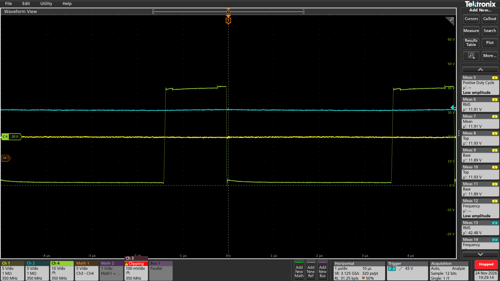

# Scope capture 2026-11-24T17:42:25 — ov03_fast

- Instrument: TEKTRONIX,MSO54,C017217,CF:91.1CT FV:2.8.1.1496
- Acquisition: 0 / SAMPLE / stop after SEQUENCE, 1 acqs
- Timebase: 1 µs/div, record 31250 pts, 3.125 GS/s
- Trigger: EDGE CH2 RISE @ 43 V, mode NORMAL

## Channels

| Ch | Label | Scale/div | Offset | Pos (div) | Coupling | BW | Term |
|---|---|---|---|---|---|---|---|
| CH1 |  | 5 V | 12 V | 0.0 | DC | 350 MHz | 1 MΩ |
| CH2 |  | 5 V | 37 V | 0.0 | DC | 350 MHz | 1 MΩ |
| CH3 |  | 100 mV | 350 mV | 0.0 | DC | 350 MHz | 250 kΩ |
| CH4 |  | 10 V | 20 V | 0.0 | DC | 350 MHz | 250 kΩ |

## Measurements

| Meas | Type | Source | Current mean | All mean | All min | All max | All σ | N |
|---|---|---|---|---|---|---|---|---|
| MEAS1 | MEAN | CH2 | 42.48 V | 42.48 V | 42.48 V | 42.48 V | 0 V | 1 |
| MEAS2 | MEAN | CH4 | 11.76 V | 11.76 V | 11.76 V | 11.76 V | 0 V | 1 |
| MEAS3 | FREQUENCY | CH2 | — | — | — | — | — | 0 |
| MEAS4 | PWIDTH | CH1 | — | — | — | — | — | 0 |
| MEAS5 | PDUTY | CH1 | — | — | — | — | — | 0 |
| MEAS6 | RMS | CH1 | 11.91 V | 11.91 V | 11.91 V | 11.91 V | 0 V | 1 |
| MEAS7 | MEAN | CH1 | 11.91 V | 11.91 V | 11.91 V | 11.91 V | 0 V | 1 |
| MEAS8 | TOP | CH1 | 11.93 V | 11.93 V | 11.93 V | 11.93 V | 0 V | 1 |
| MEAS9 | BASE | CH1 | 11.89 V | 11.89 V | 11.89 V | 11.89 V | 0 V | 1 |
| MEAS10 | TOP | CH1 | 11.93 V | 11.93 V | 11.93 V | 11.93 V | 0 V | 1 |
| MEAS11 | BASE | CH1 | 11.89 V | 11.89 V | 11.89 V | 11.89 V | 0 V | 1 |
| MEAS12 | FREQUENCY | CH1 | — | — | — | — | — | 0 |
| MEAS13 | RMS | CH2 | 42.48 V | 42.48 V | 42.48 V | 42.48 V | 0 V | 1 |
| MEAS14 | FREQUENCY | CH2 | — | — | — | — | — | 0 |
| MEAS15 | MEAN | CH3 | — | — | — | — | 0 V | 1 |

## Waveforms (waveforms.npz)

| Ch | Points | Min | Max | Mean | RMS |
|---|---|---|---|---|---|
| CH1 | 31250 | 11.61 V | 12.18 V | 11.91 V | 11.91 V |
| CH2 | 31250 | 42.25 V | 42.96 V | 42.48 V | 42.48 V |
| CH3 | 31250 | 862 mV | 862 mV | 862 mV | 862 mV |
| CH4 | 31250 | -496.9 mV | 41.32 V | 11.76 V | 20.76 V |

