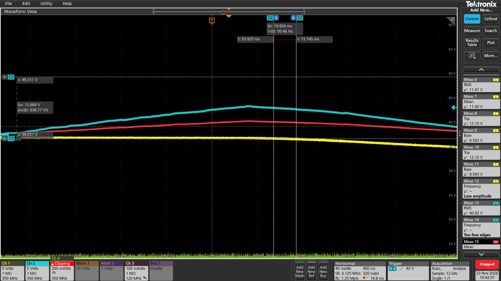

# Scope capture 2026-11-23T17:55:07 — ov02

- Instrument: TEKTRONIX,MSO54,C017217,CF:91.1CT FV:2.8.1.1496
- Acquisition: 0 / SAMPLE / stop after SEQUENCE, 1 acqs
- Timebase: 40 ms/div, record 1250000 pts, 3.125 MS/s
- Trigger: EDGE CH2 RISE @ 43 V, mode NORMAL

## Channels

| Ch | Label | Scale/div | Offset | Pos (div) | Coupling | BW | Term |
|---|---|---|---|---|---|---|---|
| CH1 |  | 5 V | 12 V | 0.0 | DC | 350 MHz | 1 MΩ |
| CH2 |  | 5 V | 37 V | 0.0 | DC | 350 MHz | 1 MΩ |
| CH3 |  | 100 mA | 350 mA | 0.0 | DC | 120 MHz | 1 MΩ |
| CH4 |  | 200 mV | 1 V | 0.0 | DC | 350 MHz | 250 kΩ |

## Measurements

| Meas | Type | Source | Current mean | All mean | All min | All max | All σ | N |
|---|---|---|---|---|---|---|---|---|
| MEAS1 | MEAN | CH2 | 40.89 V | 40.89 V | 40.89 V | 40.89 V | 0 V | 1 |
| MEAS2 | MEAN | CH4 | -1.96 mV | -1.96 mV | -1.96 mV | -1.96 mV | 0 V | 1 |
| MEAS3 | FREQUENCY | CH2 | — | — | — | — | — | 0 |
| MEAS4 | PWIDTH | CH1 | — | — | — | — | — | 0 |
| MEAS5 | PDUTY | CH1 | — | — | — | — | — | 0 |
| MEAS6 | RMS | CH1 | 11.41 V | 11.41 V | 11.41 V | 11.41 V | 0 V | 1 |
| MEAS7 | MEAN | CH1 | 11.4 V | 11.4 V | 11.4 V | 11.4 V | 0 V | 1 |
| MEAS8 | TOP | CH1 | 12.1 V | 12.1 V | 12.1 V | 12.1 V | 0 V | 1 |
| MEAS9 | BASE | CH1 | 9.593 V | 9.593 V | 9.593 V | 9.593 V | 0 V | 1 |
| MEAS10 | TOP | CH1 | 12.1 V | 12.1 V | 12.1 V | 12.1 V | 0 V | 1 |
| MEAS11 | BASE | CH1 | 9.593 V | 9.593 V | 9.593 V | 9.593 V | 0 V | 1 |
| MEAS12 | FREQUENCY | CH1 | — | — | — | — | — | 0 |
| MEAS13 | RMS | CH2 | 40.92 V | 40.92 V | 40.92 V | 40.92 V | 0 V | 1 |
| MEAS14 | FREQUENCY | CH2 | — | — | — | — | — | 0 |
| MEAS15 | MEAN | CH3 | 391.9 mA | 391.9 mA | 391.9 mA | 391.9 mA | 0 A | 1 |

## Waveforms (waveforms.npz)

| Ch | Points | Min | Max | Mean | RMS |
|---|---|---|---|---|---|
| CH1 | 1250000 | 9.593 V | 12.1 V | 11.4 V | 11.41 V |
| CH2 | 1250000 | 37.33 V | 43.51 V | 40.89 V | 40.92 V |
| CH3 | 1250000 | 355.3 mA | 419.5 mA | 391.9 mA | 392.2 mA |
| CH4 | 1250000 | -23.97 mV | 53.97 mV | -1.983 mV | 4.531 mV |

