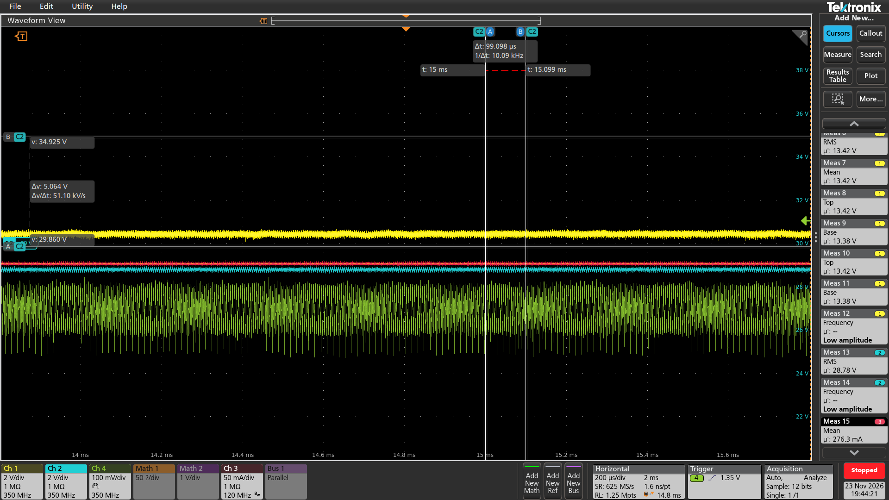

# Scope capture 2026-11-23T17:57:20 — stp01

- Instrument: TEKTRONIX,MSO54,C017217,CF:91.1CT FV:2.8.1.1496
- Acquisition: 0 / SAMPLE / stop after SEQUENCE, 1 acqs
- Timebase: 200 µs/div, record 1250000 pts, 625 MS/s
- Trigger: EDGE CH4 RISE @ 1.352 V, mode NORMAL

## Channels

| Ch | Label | Scale/div | Offset | Pos (div) | Coupling | BW | Term |
|---|---|---|---|---|---|---|---|
| CH1 |  | 2 V | 13 V | 0.0 | DC | 350 MHz | 1 MΩ |
| CH2 |  | 2 V | 30 V | 0.0 | DC | 350 MHz | 1 MΩ |
| CH3 |  | 50 mA | 300 mA | 0.0 | DC | 120 MHz | 1 MΩ |
| CH4 |  | 100 mV | 1.3 V | 0.0 | DC | 350 MHz | 250 kΩ |

## Measurements

| Meas | Type | Source | Current mean | All mean | All min | All max | All σ | N |
|---|---|---|---|---|---|---|---|---|
| MEAS1 | MEAN | CH2 | 28.78 V | 28.78 V | 28.78 V | 28.78 V | 0 V | 1 |
| MEAS2 | MEAN | CH4 | 1.148 V | 1.148 V | 1.148 V | 1.148 V | 0 V | 1 |
| MEAS3 | FREQUENCY | CH2 | — | — | — | — | — | 0 |
| MEAS4 | PWIDTH | CH1 | — | — | — | — | — | 0 |
| MEAS5 | PDUTY | CH1 | — | — | — | — | — | 0 |
| MEAS6 | RMS | CH1 | 13.42 V | 13.42 V | 13.42 V | 13.42 V | 0 V | 1 |
| MEAS7 | MEAN | CH1 | 13.42 V | 13.42 V | 13.42 V | 13.42 V | 0 V | 1 |
| MEAS8 | TOP | CH1 | 13.42 V | 13.42 V | 13.42 V | 13.42 V | 0 V | 1 |
| MEAS9 | BASE | CH1 | 13.38 V | 13.38 V | 13.38 V | 13.38 V | 0 V | 1 |
| MEAS10 | TOP | CH1 | 13.42 V | 13.42 V | 13.42 V | 13.42 V | 0 V | 1 |
| MEAS11 | BASE | CH1 | 13.38 V | 13.38 V | 13.38 V | 13.38 V | 0 V | 1 |
| MEAS12 | FREQUENCY | CH1 | — | — | — | — | — | 0 |
| MEAS13 | RMS | CH2 | 28.78 V | 28.78 V | 28.78 V | 28.78 V | 0 V | 1 |
| MEAS14 | FREQUENCY | CH2 | — | — | — | — | — | 0 |
| MEAS15 | MEAN | CH3 | 276.3 mA | 276.3 mA | 276.3 mA | 276.3 mA | 0 A | 1 |

## Waveforms (waveforms.npz)

| Ch | Points | Min | Max | Mean | RMS |
|---|---|---|---|---|---|
| CH1 | 1250000 | 13.09 V | 13.67 V | 13.42 V | 13.42 V |
| CH2 | 1250000 | 28.6 V | 28.95 V | 28.78 V | 28.78 V |
| CH3 | 1250000 | 273 mA | 280.3 mA | 276.3 mA | 276.3 mA |
| CH4 | 1250000 | 1.036 V | 1.222 V | 1.148 V | 1.149 V |

