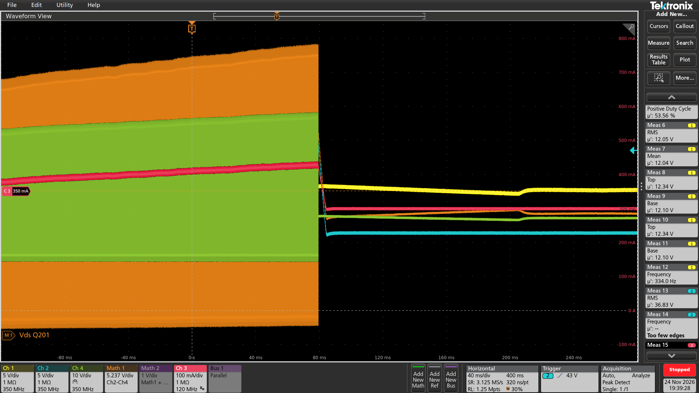

# Scope capture 2026-11-24T17:52:25 — ov03_long

- Instrument: TEKTRONIX,MSO54,C017217,CF:91.1CT FV:2.8.1.1496
- Acquisition: 0 / PEAKDETECT / stop after SEQUENCE, 1 acqs
- Timebase: 40 ms/div, record 1250000 pts, 3.125 MS/s
- Trigger: EDGE CH2 RISE @ 43 V, mode NORMAL

## Channels

| Ch | Label | Scale/div | Offset | Pos (div) | Coupling | BW | Term |
|---|---|---|---|---|---|---|---|
| CH1 |  | 5 V | 12 V | 0.0 | DC | 350 MHz | 1 MΩ |
| CH2 |  | 5 V | 37 V | 0.0 | DC | 350 MHz | 1 MΩ |
| CH3 |  | 100 mA | 350 mA | 0.0 | DC | 120 MHz | 1 MΩ |
| CH4 |  | 10 V | 20 V | 0.0 | DC | 350 MHz | 250 kΩ |

## Measurements

| Meas | Type | Source | Current mean | All mean | All min | All max | All σ | N |
|---|---|---|---|---|---|---|---|---|
| MEAS1 | MEAN | CH2 | 36.41 V | 36.41 V | 36.41 V | 36.41 V | 0 V | 1 |
| MEAS2 | MEAN | CH4 | 11.89 V | 11.89 V | 11.89 V | 11.89 V | 0 V | 1 |
| MEAS3 | FREQUENCY | CH2 | — | — | — | — | — | 0 |
| MEAS4 | PWIDTH | CH1 | 16.9 ms | 16.9 ms | 2.127 µs | 50.56 ms | 29.15 ms | 3 |
| MEAS5 | PDUTY | CH1 | 53.56 % | 53.56 % | 8.6 % | 98.52 % | 63.58 % | 2 |
| MEAS6 | RMS | CH1 | 12.05 V | 12.05 V | 12.05 V | 12.05 V | 0 V | 1 |
| MEAS7 | MEAN | CH1 | 12.04 V | 12.04 V | 12.04 V | 12.04 V | 0 V | 1 |
| MEAS8 | TOP | CH1 | 12.34 V | 12.34 V | 12.34 V | 12.34 V | 0 V | 1 |
| MEAS9 | BASE | CH1 | 12.1 V | 12.1 V | 12.1 V | 12.1 V | 0 V | 1 |
| MEAS10 | TOP | CH1 | 12.34 V | 12.34 V | 12.34 V | 12.34 V | 0 V | 1 |
| MEAS11 | BASE | CH1 | 12.1 V | 12.1 V | 12.1 V | 12.1 V | 0 V | 1 |
| MEAS12 | FREQUENCY | CH1 | 334 Hz | 334 Hz | 19.49 Hz | 648.5 Hz | 444.8 Hz | 2 |
| MEAS13 | RMS | CH2 | 36.83 V | 36.83 V | 36.83 V | 36.83 V | 0 V | 1 |
| MEAS14 | FREQUENCY | CH2 | — | — | — | — | — | 0 |
| MEAS15 | MEAN | CH3 | 351.5 mA | 351.5 mA | 351.5 mA | 351.5 mA | 0 A | 1 |

## Waveforms (waveforms.npz)

| Ch | Points | Min | Max | Mean | RMS |
|---|---|---|---|---|---|
| CH1 | 1250000 | 11.39 V | 13.26 V | 11.92 V | 11.92 V |
| CH2 | 1250000 | 38.7 V | 44.91 V | 41.85 V | 41.88 V |
| CH3 | 1250000 | 366.8 mA | 438.1 mA | 403.3 mA | 403.6 mA |
| CH4 | 1250000 | -882.8 mV | 43.28 V | 11.69 V | 20.65 V |

